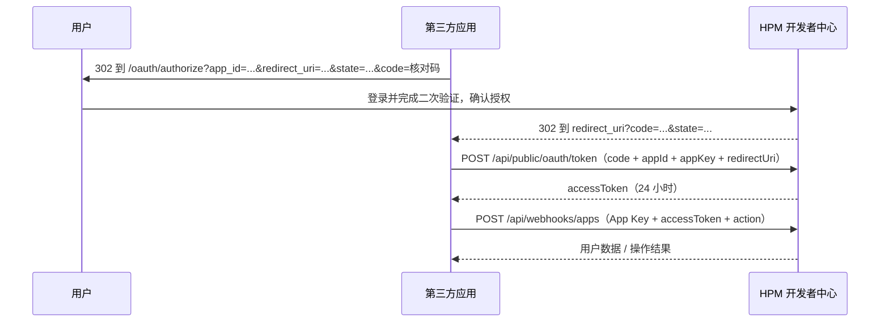

# 第三方应用接入指南

本文档面向需要接入 HPM 开发者中心的第三方应用开发者，说明如何创建应用、完成 OAuth 授权、换取 Access Token，以及通过应用 API 读取/修改用户的 HPM 数据（包与开发者）。


## 1. 接入流程概览



要点：

- `App ID` / `App Key` 是**应用级**长期凭据；`accessToken` 是**用户级**短期凭据。
- 应用 API 同时校验 `Authorization: Bearer <App Key>` 和请求体里的 `accessToken`。
- 线上回调地址必须精确命中应用登记的白名单；`localhost` / `127.0.0.1` / `[::1]` 等本地地址自动放行，便于本地开发。

## 2. 创建应用

1. 用户登录后进入 **应用程序** 页面，点击 **创建我的应用**。
2. 填写：
   - 应用名称（必填）
   - 应用描述
   - 应用 Logo（可选，最大约 1 MB）
   - **回调地址**（可选，每行一个，必须是 `http(s)://` 绝对地址，不能带 `#fragment`，最多 10 个；本地开发可留空）
3. 完成敏感操作二次验证（2FA 或邮箱验证码）后创建成功。
4. 页面会**只显示一次** `App ID` 和 `App Key`，请立即保存。

> `App Key` 在数据库中只保存 SHA-256 摘要，无法找回。遗失后请删除应用并重新创建，或联系管理员。
>
> 回调地址后续可通过应用列表里的 **设置回调地址** 修改，同样需要二次验证。
>
> 本地回调（`localhost` / `127.0.0.1` / `[::1]`）不需要登记，创建应用时留空即可。

## 3. 发起授权

把用户重定向到：

```
https://hpm.astercore.dpdns.org/oauth/authorize?app_id=<APP_ID>&redirect_uri=<回调地址>&state=<随机串>&code=<核对码>
```

| 参数 | 必填 | 说明 |
| --- | --- | --- |
| `app_id` | ✅ | 创建应用后获得的 App ID |
| `redirect_uri` | ✅ | 本地地址（localhost / 127.0.0.1 / [::1]）自动放行；其它地址必须与应用登记的地址**完全一致**（含协议、端口、路径、末尾斜杠） |
| `state` | 推荐 | 随机字符串，用于防 CSRF；授权成功后会原样带回 |
| `code` | 推荐 | 由第三方生成的**核对码**，会原样显示在授权页面上，供用户与第三方应用界面上的提示核对 |

关于 `code`（核对码）：

- 它是给**人眼核对**的，不是 OAuth 授权码。建议每次发起授权时随机生成一个短码（如 `ABCD-1234`），并在自己的应用界面同时展示。
- 用户在 HPM 授权页看到该码后，与第三方应用上显示的码比对一致再确认授权，可防止授权页被掉包/诱导授权。
- 不传该参数时授权页不会显示核对区块，保持向后兼容。
- 回调地址里的 `code` 是 OAuth 授权码，与这里的核对码无关。

流程说明：

- 未登录用户会先被引导到登录页。
- 授权页会展示应用名称与申请权限；用户需完成 2FA 或邮箱验证码确认。
- 用户点击 **拒绝** 时停在当前页/返回上一页，**不会**回调 `redirect_uri`。
- 非本地且未登记的回调地址，授权页会直接报错，不会展示确认界面。

授权成功后回调：

```
<redirect_uri>?code=<一次性授权码>&state=<原样返回的 state>
```

- `code` 有效期 **10 分钟**，只能使用一次，且与 `appId`、`redirect_uri` 绑定。
- 请务必校验回调里的 `state` 与发起时一致。

### 本地开发

- `http://localhost:<端口>/...`、`http://127.0.0.1:<端口>/...`、`http://[::1]:<端口>/...` 会被自动放行，**不需要在应用里登记回调地址**。
- 创建应用或修改回调地址时，本地开发可以直接留空。
- 本地回调仍需与授权时使用的 `redirect_uri` 完全一致（端口、路径、末尾斜杠都要一致）。
- 上线前请把正式域名回调地址登记到应用里。

## 4. 换取 Access Token

```http
POST /api/public/oauth/token
Content-Type: application/json
```

```json
{
  "code": "<授权码>",
  "appId": "<APP_ID>",
  "appKey": "<APP_KEY>",
  "redirectUri": "http://localhost:3000/callback"
}
```

成功响应：

```json
{
  "success": true,
  "accessToken": "<64 位十六进制字符串>",
  "expiresIn": 86400
}
```

说明：

- `redirectUri` 必填，且必须与授权时使用的地址一致（本地地址同样要一致）。
- `accessToken` 有效期 **24 小时**，服务端只保存其 SHA-256 摘要；遗失只能让用户重新授权。
- 该接口按 IP 限流：**30 次/分钟**。
- 失败返回纯文本，常见状态码见第 7 节。

## 5. 调用应用 API

统一入口：

```http
POST /api/webhooks/apps
Authorization: Bearer <APP_KEY>
Content-Type: application/json
```

```json
{
  "action": "<动作名>",
  "accessToken": "<用户 accessToken>",
  "payload": { }
}
```

> 注意：`Authorization` 里放的是长期 **App Key**，`accessToken` 放在 JSON body 里，两者缺一不可。

### 5.1 支持的动作

| action | 作用 | `payload` |
| --- | --- | --- |
| `get_user` | 读取用户资料 | 不需要 |
| `get_packages` | 读取用户的包列表 | 不需要 |
| `update_package` | 新建/覆盖包与版本 | 见 5.4 |
| `get_developers` | 读取用户的开发者列表 | 不需要 |
| `update_developer` | 新建/更新开发者 | 见 5.5 |

### 5.2 `get_user` — 读取用户资料

```json
{ "action": "get_user", "accessToken": "<token>" }
```

```json
{
  "name": "张三",
  "email": "dev@example.com",
  "githubUrl": "https://github.com/octocat",
  "pgpKey": "-----BEGIN PGP PUBLIC KEY BLOCK-----...",
  "sshKey": "ssh-ed25519 AAAAC3...",
  "repoUrl": "https://example.com/hpm"
}
```

未绑定的字段为 `null`。`githubUrl` 需要用户绑定 GitHub 才能解析。

### 5.3 `get_packages` — 读取包列表

```json
{ "action": "get_packages", "accessToken": "<token>" }
```

返回包的基础信息数组（**不含版本列表**）：

```json
[
  {
    "id": "pkg_xxx",
    "userId": "user_xxx",
    "name": "stm32",
    "kind": "driver",
    "developerId": "dev_xxx",
    "requiresJson": "{}",
    "createdAt": "2026-01-01T00:00:00.000Z"
  }
]
```

### 5.4 `update_package` — 新建或覆盖包版本

```json
{
  "action": "update_package",
  "accessToken": "<token>",
  "payload": {
    "name": "stm32",
    "kind": "driver",
    "requiresJson": "{\"stm32f1\":\"1.0.0\"}",
    "version": "1.2.0",
    "url": "https://example.com/hpm/stm32/1.2.0.zip",
    "sigUrl": "https://example.com/hpm/stm32/1.2.0.zip.sig",
    "sha256": "0123...abcd",
    "size": 102400,
    "license": "MIT"
  }
}
```

| 字段 | 必填 | 说明 |
| --- | --- | --- |
| `name` | ✅ | 包名，同名视为同一个包 |
| `kind` | ✅ | 包类型，如 `driver` / `chip` |
| `version` | ✅ | 版本号，相同包 + 相同版本会被覆盖 |
| `url` / `sigUrl` | ✅ | 包与签名的下载地址 |
| `sha256` | ✅ | 包文件 SHA-256 |
| `requiresJson` | 否 | 依赖 JSON 字符串，默认 `"{}"` |
| `size` | 否 | 字节数，默认 `0` |
| `license` | 否 | 默认 `MIT` |

成功响应：

```json
{ "success": true, "message": "Package updated (overwritten) successfully" }
```

### 5.5 `get_developers` — 读取开发者列表

```json
{ "action": "get_developers", "accessToken": "<token>" }
```

```json
[
  {
    "id": "a1b2c3d4e5f60718",
    "name": "dev-one",
    "pubUrl": "https://example.com/dev-one/dev-one.pub",
    "pubSigUrl": "https://example.com/dev-one/dev-one.pub.sig",
    "isVerified": true,
    "createdAt": "2026-01-01T00:00:00.000Z"
  }
]
```

按 `createdAt` 升序返回。

### 5.6 `update_developer` — 新建或更新开发者

```json
{
  "action": "update_developer",
  "accessToken": "<token>",
  "payload": {
    "name": "dev-one",
    "pubUrl": "https://example.com/dev-one/dev-one.pub",
    "pubSigUrl": "https://example.com/dev-one/dev-one.pub.sig"
  }
}
```

| 字段 | 必填 | 说明 |
| --- | --- | --- |
| `name` | ✅ | 开发者名称，最长 64 字符；同名视为同一个开发者 |
| `pubUrl` | ✅ | 公钥文件地址，必须是 `http(s)` 绝对 URL |
| `pubSigUrl` | ✅ | 公钥签名文件地址，必须是 `http(s)` 绝对 URL |

行为：

- 按 `(用户, name)` 唯一确定一条记录：不存在则创建，存在则更新。
- **公钥地址发生变化时，`isVerified` 会自动重置为 `false`**，需要用户回到控制台重新验签；地址不变则保留原状态。
- 应用侧无法直接把 `isVerified` 置为 `true`。
- 目前不提供删除动作；删除开发者需用户在控制台操作。

响应：

```json
// 新建
{ "success": true, "id": "a1b2c3d4e5f60718", "created": true }

// 更新
{ "success": true, "id": "a1b2c3d4e5f60718", "created": false, "verifiedReset": true }
```

## 6. 权限、撤销与账号状态

- 授权页当前展示的权限为：
  - 读取您的个人信息（只读）
  - 读取和修改您的 HPM 包列表
- 开发者列表的读写属于"包管理"授权范围内，不额外申请新的 scope。
- 用户可在 **应用程序 → 我授权的应用** 中随时 **取消授权**。取消后：
  - 该应用不再能使用已签发的 Access Token（调用返回 403 `User revoked authorization`）；
  - 需要用户重新授权才能继续使用。
- 用户账号被管理员 **冻结** 时，应用 API 返回 403 `User account is frozen`。
- 删除应用会级联删除其授权与 Token。

## 7. 错误状态码

应用 API（`/api/webhooks/apps`）：

| 状态码 | 返回示例 | 含义 |
| --- | --- | --- |
| 400 | `Missing action or accessToken` | 缺少 `action` / `accessToken`，或 `payload` 字段缺失/格式错误 |
| 400 | `Invalid action` | 不支持的动作 |
| 401 | `Invalid App Key` | `Authorization` 中的 App Key 不正确 |
| 401 | `Invalid or expired access token` | `accessToken` 不存在、已过期或不属于该应用 |
| 403 | `User revoked authorization` | 用户已取消授权 |
| 403 | `User account is frozen` | 用户账号被冻结 |
| 500 | 具体错误信息 | 服务端异常 |

Token 交换（`/api/public/oauth/token`）：

| 状态码 | 返回示例 | 含义 |
| --- | --- | --- |
| 400 | `Missing fields` / `Missing redirectUri` | 参数不完整 |
| 400 | `Invalid or expired code` | code 不存在或超过 10 分钟 |
| 400 | `redirect_uri mismatch` | 回调地址与授权时或登记的不一致 |
| 401 | `Invalid App credentials` | appId / appKey 不匹配 |
| 403 | `User not authorized` | 用户授权记录不存在 |
| 429 | `Too Many Requests` | 触发限流 |

## 8. 完整示例（curl）

```bash
# 1) 用 code 换 token
curl -s -X POST https://hpm.astercore.dpdns.org/api/public/oauth/token \
  -H "Content-Type: application/json" \
  -d '{
    "code": "'"$CODE"'",
    "appId": "'"$APP_ID"'",
    "appKey": "'"$APP_KEY"'",
    "redirectUri": "http://localhost:3000/callback"
  }'

# 2) 读取开发者列表
curl -s -X POST https://hpm.astercore.dpdns.org/api/webhooks/apps \
  -H "Authorization: Bearer $APP_KEY" \
  -H "Content-Type: application/json" \
  -d '{"action":"get_developers","accessToken":"'"$ACCESS_TOKEN"'"}'

# 3) 新建/更新开发者
curl -s -X POST https://hpm.astercore.dpdns.org/api/webhooks/apps \
  -H "Authorization: Bearer $APP_KEY" \
  -H "Content-Type: application/json" \
  -d '{
    "action": "update_developer",
    "accessToken": "'"$ACCESS_TOKEN"'",
    "payload": {
      "name": "dev-one",
      "pubUrl": "https://example.com/dev-one/dev-one.pub",
      "pubSigUrl": "https://example.com/dev-one/dev-one.pub.sig"
    }
  }'
```

## 9. 安全建议

1. **线上回调地址**必须使用 HTTPS，并严格按白名单精确匹配，不要做通配；本地地址自动放行仅用于开发调试。
2. **校验 `state`**，防止授权回调 CSRF。
3. **App Key 只能保存在服务端**，不要下发到浏览器/移动端。
4. `code` 一次性且 10 分钟过期；`accessToken` 24 小时过期，请勿长期缓存。
5. 只申请/使用必要的动作，用户取消授权后立即停止调用并清理本地缓存的 Token。
6. 应用 API 返回的用户公钥（PGP / SSH）是公开信息，但仍应按个人信息处理，避免日志泄露。
7. 使用 `code` 核对码时，务必随机生成并在自己的界面上同步展示，授权完成后即作废，不要重复使用。
